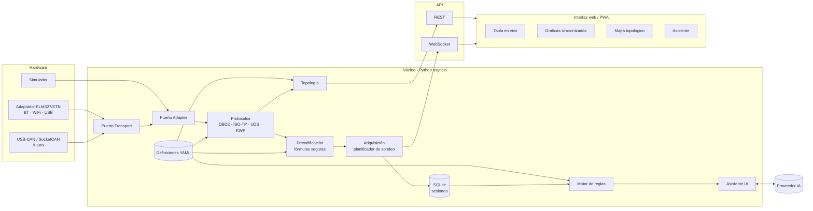
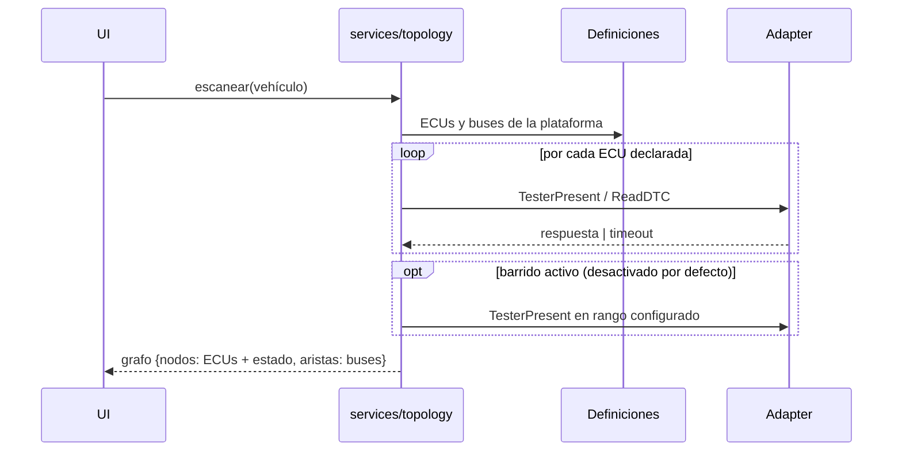
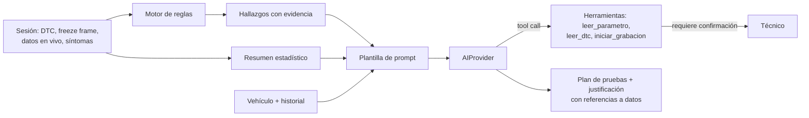

# Arquitectura — Plataforma de diagnóstico automotriz multimarca

> **Estado:** BORRADOR v0.1 — propuesta para revisión. Las decisiones marcadas con
> **D-xx** están abiertas y se detallan en [`03-decisiones-abiertas.md`](03-decisiones-abiertas.md).

## 1. Principios

1. **Arquitectura hexagonal (puertos y adaptadores).** El núcleo (protocolos, decodificación,
   análisis) no conoce el hardware, la base de datos ni el proveedor de IA. Todo lo externo
   entra por una interfaz (*puerto*) con implementaciones intercambiables.
2. **Datos, no código.** PIDs, DIDs, ECUs, buses, reglas, prompts, textos de UI y configuración
   viven en archivos versionados y validados por esquema (RNF-06, RNF-10).
3. **Solo lectura por defecto.** La capa de protocolo expone únicamente servicios de lectura
   y borrado de DTC; cualquier servicio con efecto queda fuera hasta decisión explícita (D-07).
4. **Simulador de primera clase.** El simulador implementa el mismo puerto que un adaptador
   real; todo se desarrolla y prueba contra él (RU-03, RNF-09).
5. **Normas como referencia.** Toda constante de protocolo cita su norma (SAE J1979, ISO 15765,
   ISO 14229…) en un módulo de constantes con nombre, nunca como "número mágico".

## 2. Vista general



## 3. Capas y responsabilidades

| Capa | Paquete | Responsabilidad | Depende de |
|---|---|---|---|
| Dominio | `core/domain` | Modelos inmutables: `Vehicle`, `Ecu`, `Bus`, `SignalDef`, `Sample`, `Dtc`, `FreezeFrame`, `Session` | — |
| Puertos | `core/ports` | Interfaces abstractas: `Transport`, `Adapter`, `SessionRepository`, `DefinitionSource`, `AIProvider` | dominio |
| Protocolos | `core/protocols` | Codificación/decodificación de mensajes según norma. Sin E/S. | dominio |
| Decodificación | `core/decoding` | Evaluador de fórmulas restringido, conversión de unidades | dominio |
| Definiciones | `core/definitions` | Carga + validación por esquema de YAML; catálogo consultable | dominio |
| Servicios | `services/*` | Casos de uso: adquisición, lectura de DTC, escaneo de topología, análisis, asistente | puertos, protocolos |
| Infraestructura | `infra/*` | Implementaciones de puertos: transportes, adaptadores, SQLite, proveedores IA, simulador | puertos |
| API | `api` | FastAPI: REST + WebSocket. Solo orquesta servicios. | servicios |
| UI | `ui/` | Frontend web/PWA | API (HTTP/WS) |

**Regla de dependencias:** las flechas solo apuntan hacia el dominio. `core` nunca importa
`infra`, `api` ni `ui`. Se verificará en CI con `import-linter`.

## 4. Puertos principales (contratos)

```python
class Transport(Protocol):
    """Canal de bytes crudo (BT SPP, TCP, serie). No sabe nada de OBD."""
    async def open(self) -> None: ...
    async def close(self) -> None: ...
    async def write(self, data: bytes) -> None: ...
    async def read_until(self, terminator: bytes, timeout_s: float) -> bytes: ...

class Adapter(Protocol):
    """Interfaz de diagnóstico: envía una petición a una ECU y devuelve sus respuestas."""
    async def connect(self) -> AdapterInfo: ...           # detecta protocolo del vehículo
    async def request(self, req: DiagRequest) -> list[DiagResponse]: ...
    async def set_target(self, ecu: EcuAddress) -> None: ...  # dirección física/funcional
    capabilities: AdapterCapabilities                     # CAN FD, K-Line, monitor CAN…

class AIProvider(Protocol):
    async def chat(self, messages: list[Message], tools: list[ToolSpec]) -> AIResponse: ...
```

`Adapter` trabaja con **mensajes de diagnóstico completos**: en ELM327/STN la segmentación ISO-TP
la hace el propio adaptador; en un adaptador CAN nativo la hará `core/protocols/isotp`.
Así la capa UDS es idéntica en ambos casos.

## 5. Formato de definiciones

### 5.1 PID OBD2 (`definitions/obd2/pids.yaml`)
```yaml
schema_version: 1
pids:
  - id: "0C"                 # PID modo 01 (SAE J1979)
    key: engine_rpm          # identificador estable usado en código, reglas y plantillas
    name: { es: "RPM motor", en: "Engine RPM" }
    bytes: 2
    formula: "(A*256 + B) / 4"   # lenguaje restringido: A..D, + - * / (), min, max, bit()
    unit: rpm
    range: { min: 0, max: 16383.75 }
    category: engine
```

### 5.2 Marca / plataforma (`definitions/brands/<marca>/<plataforma>.yaml`)
```yaml
schema_version: 1
brand: ejemplo
platform: ejemplo-2018
match:                       # cómo se reconoce el vehículo
  vin_wmi: ["XXX"]
  years: [2016, 2022]
buses:
  - id: hs_can
    type: can
    bitrate: 500000
    name: { es: "CAN alta velocidad" }
  - id: ms_can
    type: can
    bitrate: 125000
ecus:
  - id: ecm
    name: { es: "Módulo de control de motor" }
    bus: hs_can
    protocol: uds
    request_id: 0x7E0
    response_id: 0x7E8
    dids: ecm_dids           # referencia a un archivo de DIDs
  - id: gateway
    bus: [hs_can, ms_can]    # un gateway pertenece a varios buses
    role: gateway
    ...
layout:                      # opcional; si falta, disposición automática
  ecm: { x: 0, y: 0 }
```

> Los valores de este ejemplo son ilustrativos. Las direcciones reales de cada marca se
> cargan solo desde fuentes verificadas (ver D-08).

### 5.3 Reglas de análisis (`definitions/rules/*.yaml`)
```yaml
- id: fuel_trim_lean_idle_only
  description: { es: "Mezcla pobre solo en ralentí: sugiere toma de aire" }
  when:
    all:
      - { signal: engine_rpm, stat: mean, op: "<", value: 1000 }
      - { signal: ltft_b1,    stat: mean, op: ">", value: 10 }
  severity: warning
  evidence: [engine_rpm, ltft_b1, stft_b1, maf]
```
Los umbrales son datos: se ajustan sin tocar el código.

## 6. Flujos clave

### 6.1 Datos en vivo
1. La UI se suscribe (WS) a un conjunto de señales: **visibles** (alta prioridad) y **resto** (baja).
2. El planificador (`services/acquisition`) agrupa PIDs en peticiones multi-PID cuando la ECU lo
   soporta (hasta 6 PIDs por petición en CAN, SAE J1979) y reparte el ancho de banda por prioridad.
3. Cada respuesta se decodifica → `Sample(signal, value, t_monotonic)`.
4. Las muestras se emiten por WS en lotes (cada N ms, configurable) y, si hay grabación, se escriben en SQLite.

### 6.2 Mapa topológico

Estados: `ok`, `con_fallas`, `sin_respuesta`, `no_verificado`, `desconocido` (respondió pero no
está en la definición). La UI lo dibuja con **Cytoscape.js** (D-05).

### 6.3 Asistente IA

- El resumen estadístico (mín./máx./media/percentiles, correlaciones relevantes) reduce costo
  y evita enviar datos crudos (RS-42).
- Cada afirmación de la IA debe citar la señal o hallazgo que la sustenta (RU-63); el prompt lo exige
  y la UI enlaza la cita con la gráfica correspondiente.

## 7. Despliegue: Linux y Android

Ver **D-01**. Propuesta por etapas:

| Modo | Backend | UI | Adaptador | Fase |
|---|---|---|---|---|
| **A. Linux + tablet** | Python en el portátil | Navegador local o tablet Android por WiFi (PWA) | BT, USB o WiFi | 1 |
| **B. Solo Android (Termux)** | Python en Termux | Navegador del mismo equipo | **WiFi/TCP** (Termux no accede bien a Bluetooth clásico) | 1–2 |
| **C. App Android nativa** | Núcleo Python embebido (Chaquopy) + transporte Bluetooth en Kotlin | WebView con la misma UI | BT, WiFi | evaluar en 3+ |

El modo C reutiliza **el mismo núcleo y la misma UI**: solo cambia la implementación de
`Transport`, que es precisamente lo que permite la arquitectura hexagonal.

## 8. Configuración

Orden de precedencia (el último gana):
1. `config/default.yaml` (versionado, valores por defecto documentados)
2. `config/local.yaml` (no versionado, por equipo)
3. Variables de entorno `DIAG_*` (secretos, claves de API)

Se valida con `pydantic-settings`; un valor inválido detiene el arranque con un mensaje claro.

## 9. Estructura de repositorio propuesta

```
.
├── docs/                    # requisitos, arquitectura, decisiones (ADR), guías
├── config/
│   └── default.yaml
├── definitions/
│   ├── schemas/             # JSON Schema de cada tipo de definición
│   ├── obd2/                # pids.yaml, modos, DTC genéricos
│   ├── brands/<marca>/      # plataformas, DIDs, DTC propietarios
│   ├── rules/               # reglas de análisis
│   ├── templates/           # plantillas de datos en vivo por tipo de avería
│   └── vehicles/sim/        # vehículos para el simulador
├── prompts/                 # plantillas del asistente IA
├── i18n/                    # textos de la UI
├── src/diag/
│   ├── core/{domain,ports,protocols,decoding,definitions}/
│   ├── services/{acquisition,dtc,topology,analysis,assistant}/
│   ├── infra/{transports,adapters,storage,ai,simulator}/
│   └── api/
├── ui/                      # frontend (D-04)
└── tests/{unit,integration}/
```

## 10. Stack propuesto

| Área | Elección | Motivo |
|---|---|---|
| Lenguaje núcleo | Python ≥ 3.11, `asyncio` | Ecosistema automotriz (python-can, udsoncan), rapidez de desarrollo |
| Validación | `pydantic` v2 + JSON Schema | Modelos tipados y errores legibles |
| Fórmulas | Evaluador AST propio con lista blanca | Sin `eval`, sin dependencias (RS-13) |
| API | FastAPI + WebSocket | Async nativo, documentación OpenAPI automática |
| Almacenamiento | SQLite (`aiosqlite`) | Un archivo por base, offline, portable a Android |
| Gráficas | uPlot | Miles de puntos a 60 fps, muy liviano (RNF-02) |
| Topología | Cytoscape.js | Grafos interactivos, disposición automática |
| Calidad | `ruff`, `mypy --strict`, `pytest`, `import-linter` | Estilo, tipos, pruebas, reglas de capas |
